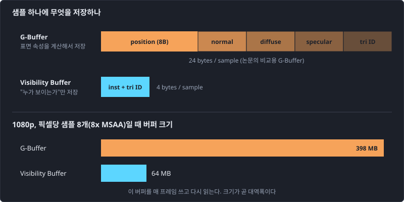
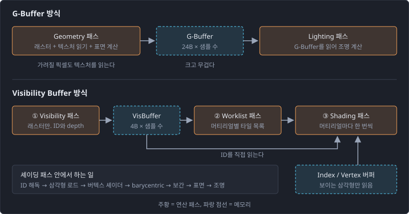
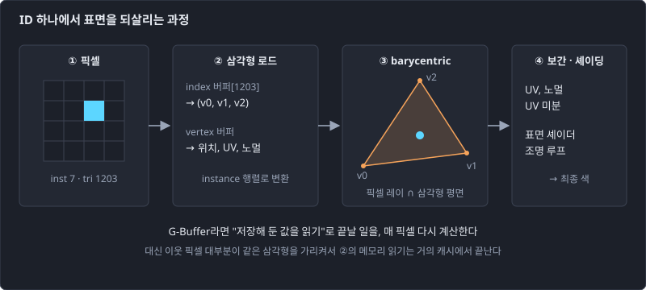
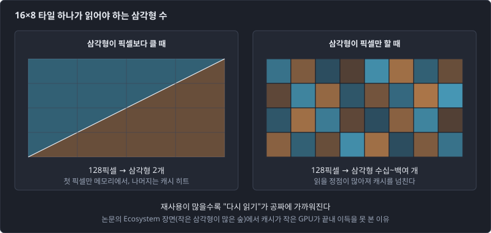
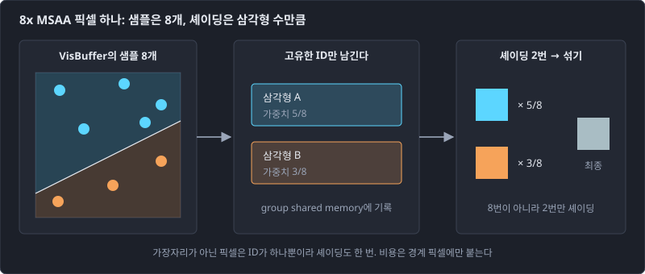
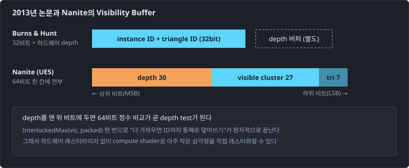

UE5의 Nanite를 설명하는 자료에는 거의 빠짐없이 "Visibility Buffer"라는 말이 나옵니다. 픽셀마다 색이나 노멀이 아니라 **"이 픽셀에 보이는 삼각형이 몇 번인가"만 저장**하고, 셰이딩은 나중에 그 번호로 삼각형을 다시 찾아서 한다는 아이디어입니다. 이 아이디어를 처음 정리해서 발표한 논문이 Intel Labs의 Christopher Burns와 Warren Hunt가 2013년에 JCGT(Journal of Computer Graphics Techniques)에 실은 **"The Visibility Buffer: A Cache-Friendly Approach to Deferred Shading"**입니다.

이 글은 그 논문을 따라 읽습니다. 1장은 논문이 풀려는 문제, 2~4장은 해법과 그 대가, 5~6장은 MSAA와 실험 결과, 7장은 이 아이디어가 10년 뒤 Nanite에서 어떻게 쓰였는지입니다.

## 1. 문제: G-Buffer는 너무 크고, 덜 미룬다

Deferred shading(지연 셰이딩)은 조명 계산을 **보이는 픽셀에만** 하려는 방법입니다. 먼저 장면을 한 번 그리면서 픽셀마다 위치, 노멀, 색 같은 표면 정보를 G-Buffer(Geometry Buffer)에 저장해 두고, 조명은 그다음 패스에서 이 버퍼를 읽어 계산합니다. 가려진 픽셀은 이미 덮어써졌으니 조명 비용을 낭비하지 않습니다.

논문은 이 방식에 두 가지 결함이 있다고 지적합니다.

**첫째, G-Buffer가 너무 큽니다.** 샘플 하나에 보통 16~32바이트를 쓰고, 매 프레임 이걸 쓰고 다시 읽습니다. 해상도나 MSAA(Multisample Anti-Aliasing) 샘플 수를 올리면 버퍼 크기가 그대로 곱해져서, 메모리 대역폭이 좁은 모바일·내장 GPU에서는 금방 한계에 닿습니다. 그래서 실제 게임은 해상도나 안티에일리어싱 중 하나를 포기하곤 합니다.

**둘째, 이름과 달리 셰이딩을 다 미루지 못합니다.** G-Buffer를 채우려면 첫 패스에서 이미 텍스처를 읽고 표면 속성을 계산해야 합니다. 그런데 이 시점에는 아직 누가 최종적으로 보일지 모르니, **나중에 가려질 픽셀도 텍스처를 읽습니다.** 첫 패스가 머티리얼 셰이더를 돌리니 드로우도 머티리얼별로 묶어야 하고, 모든 머티리얼이 같은 G-Buffer 레이아웃에 맞춰야 한다는 제약도 생깁니다.

<details markdown="1">
<summary>논문이 든 대역폭 계산, 그리고 비교용 G-Buffer 구성</summary>

논문 도입부의 예시입니다. 4메가픽셀 화면에 픽셀당 24바이트 샘플 4개, 60Hz로 돌리면 조명 패스를 한 번만 한다고 쳐도 **압축하지 않은 G-Buffer를 쓰고 읽는 데만 46GB/s**가 듭니다.

실험에 쓴 비교용 G-Buffer는 샘플당 24바이트입니다.

```hlsl
struct GBuffer {
    half4   positionXYZ_;     // 8 bytes, w 미사용
    half2   normalXY;         // 4 bytes, sphere map 인코딩
    unorm84 diffuseRGB_;      // 4 bytes
    unorm84 specularRGB_exp;  // 4 bytes
    uint    triangleID;       // 4 bytes, MSAA 처리용
};
```

<sub>출처: Burns &amp; Hunt 2013, Listing 1 (주석은 번역)</sub>

마지막 `triangleID`는 원래 G-Buffer에는 없는 값입니다. 5장의 MSAA 방식을 두 파이프라인에 똑같이 적용하려고 넣었습니다. 공정한 비교를 위해 G-Buffer 쪽에 4바이트를 더 얹어 준 셈입니다.

논문은 세 번째 문제로 반투명을 꼽습니다. G-Buffer는 샘플마다 보이는 표면이 하나라고 가정하기 때문에 반투명은 따로 forward 패스로 그립니다. 다만 이 문제는 Visibility Buffer도 풀지 않습니다.
</details>

## 2. 아이디어: "누가 보이는가"만 저장한다

해법은 단순합니다. 첫 패스에서 **표면 정보를 아예 계산하지 않습니다.** 샘플마다 "보이는 삼각형의 번호"와 "그 삼각형이 속한 인스턴스 번호"만 4바이트 정수 하나에 묶어 저장합니다. 이것이 Visibility Buffer입니다.



그러면 두 문제가 함께 풀립니다. 버퍼가 G-Buffer의 6분의 1로 줄어들고, 첫 패스는 텍스처도 머티리얼도 모르는 순수한 래스터화 패스가 됩니다. depth만 쓰는 Z-prepass와 거의 같은 비용입니다. 텍스처 읽기를 포함한 **모든** 셰이딩은 가시성이 완전히 결정된 뒤로 미뤄집니다.

<details markdown="1">
<summary>버퍼 크기 숫자, 그리고 4바이트로 모자랄 때</summary>

- 1080p에 픽셀당 샘플 8개면 Visibility Buffer는 **64MB**, 24바이트 G-Buffer는 **398MB**입니다(논문 수치).
- 대신 셰이딩 때 보이는 삼각형의 인덱스·버텍스 데이터를 읽어야 합니다. 논문 추정으로 마이크로폴리곤 200만 개 분량(삼각형당 고유 버텍스 하나, 버텍스 32바이트 가정)이 약 88MB입니다. G-Buffer보다 여전히 작고, 무엇보다 이 읽기는 화면에서 이웃한 픽셀끼리 겹칩니다(4장).
- 장면이 커서 ID가 32비트에 안 들어가거나 테셀레이션을 쓰면 샘플당 **8바이트**로 늘립니다.
- depth는 하드웨어 depth 버퍼에 따로 들어갑니다. 4바이트는 ID만의 크기입니다.
</details>

## 3. 파이프라인: 세 단계로 나눈다

논문의 파이프라인은 세 단계입니다.



1. **Visibility 패스.** 장면 전체를 래스터화해서 depth와 ID만 씁니다. 픽셀 셰이더는 `SV_PrimitiveID`를 내보내는 게 전부입니다.
2. **Worklist 패스.** 화면을 16×8 픽셀 타일로 나누고, 머티리얼마다 "이 머티리얼이 보이는 타일 목록"을 만듭니다.
3. **Shading 패스.** 머티리얼마다 compute shader를 한 번씩 dispatch하는데, 그 머티리얼의 타일 목록에 있는 타일만 돕니다. 이 커널이 버텍스 셰이딩부터 조명까지 모든 일을 하고 픽셀마다 색 하나를 씁니다.

2단계가 왜 필요한지는 G-Buffer와 반대 상황을 떠올리면 보입니다. G-Buffer 방식에서는 첫 패스가 머티리얼별로 나뉘고 조명 패스는 화면 전체에 한 번이면 됩니다. Visibility Buffer에서는 머티리얼 계산이 전부 뒤로 왔으니 셰이딩 패스를 머티리얼별로 나눠야 합니다. 그때 화면 전체를 머티리얼 수만큼 훑으면 낭비라서, 해당 머티리얼이 실제로 있는 타일만 골라 주는 단계를 끼워 넣은 것입니다.

<details markdown="1">
<summary>Worklist 패스의 구현과 비용</summary>

- 첫 단계는 Visibility Buffer를 읽어 `(타일, 셰이더)` 쌍 레코드(8바이트)를 만듭니다.
- 둘째 단계는 레코드를 셰이더 기준으로 정렬하고 타일 ID만 촘촘한 목록으로 모읍니다. 셰이더마다 목록의 어디서부터가 자기 몫인지 오프셋 배열을 둡니다.
- 논문의 모든 장면에서 이 단계는 **프레임 시간의 10%를 넘지 않았습니다.**
- 타일 크기 16×8은 group shared memory 용량(MSAA 처리에 씀)이 위쪽 한계를 정했고, 64픽셀보다 작게 하면 워크그룹이 작아져 GPU를 다 채우지 못해 느려졌다고 합니다.
- 공정한 비교를 위해 G-Buffer 쪽 조명 패스도 같은 16×8 타일 compute shader로 구현했습니다. 라이트 컬링은 두 쪽 다 하지 않고, 이미 컬링된 타일별 라이트 목록이 있다고 가정했습니다.
</details>

## 4. 대가: 저장하지 않은 것은 다시 계산한다

G-Buffer를 버린 대가는 셰이딩 패스가 치릅니다. 픽셀에는 ID밖에 없으니, 그 ID에서 표면을 처음부터 되살려야 합니다.



1. ID를 풀어 인스턴스와 삼각형 번호를 얻습니다.
2. 인덱스 버퍼에서 세 버텍스 번호를, 버텍스 버퍼에서 세 버텍스를 읽습니다.
3. 픽셀 중심을 지나는 레이와 삼각형의 교점을 구해 **barycentric 좌표**(무게중심 좌표, 삼각형 안의 점을 세 꼭짓점의 가중치로 나타낸 값)를 계산합니다. 원래는 래스터라이저가 해 주던 일입니다.
4. 이 가중치로 UV, 노멀 같은 속성을 보간하고, 텍스처 필터링에 필요한 UV 미분도 직접 계산한 뒤, 버텍스 셰이더 → 표면 셰이더 → 조명 순서로 돌립니다.

즉 **버텍스 셰이더가 픽셀마다 다시 돕니다.** 연산량만 보면 분명히 손해입니다. 논문은 이것을 대역폭과 연산을 맞바꾸는 거래로 봅니다. GPU의 연산 성능은 메모리 대역폭보다 훨씬 빠르게 늘어 왔고, 모바일에서는 메모리 접근이 전력의 큰 몫을 먹으니 "더 계산하고 덜 읽는" 쪽이 이긴다는 판단입니다. 실제로 실험한 장면들에서는 셰이더에 연산을 더 넣어도 프레임레이트가 변하지 않았습니다. 병목이 연산이 아니었다는 뜻입니다.

<details markdown="1">
<summary>셰이딩 커널 의사코드 (논문 Figure 3 정리)</summary>

머티리얼(버텍스 셰이더 + 표면 셰이더 + BRDF 조합)마다 아래 모양의 HLSL compute 커널을 생성합니다.

```hlsl
void ShadingPass(uint2 pixelID)
{
    // 샘플을 읽고 ID를 푼다
    uint vSample    = LoadVisSample(pixelID);
    uint instanceID = DecodeInstanceID(vSample);
    uint triID      = DecodeTriangleID(vSample);

    // 다른 머티리얼의 픽셀이면 건너뛴다
    if (InstToShaderMap[instanceID] != SHADER_ID) return;

    // 보이는 삼각형의 인덱스와 버텍스를 읽는다
    uint3  indices = LoadIndices(InstToIndexBase[instanceID], triID);
    Vertex v0, v1, v2;
    LoadVertices(InstToVertexBase[instanceID], indices, v0, v1, v2);

    // 레이-삼각형 교차로 barycentric을 구해 속성을 보간한다
    float4x4 objToScreen = WorldToScreen * ObjToWorld[instanceID];
    float3   b = ComputeInterpolants(v0.pos, v1.pos, v2.pos, objToScreen, pixelID);
    Vertex   v = v0 * b.x + v1 * b.y + v2 * b.z;

    // 여기서부터는 G-Buffer 방식의 조명 패스와 거의 같다
    Vertex  vs = ShadeVertex(v);      // 버텍스 셰이더
    Surface s  = ShadeSurface(vs);    // 표면 셰이더
    float4  color = 0;
    for (uint i = 0; i < NumLights; ++i)
        color += ShadeBRDF(s, ShadeLightSource(s, i));

    WriteColor(pixelID, color);
}
```

<sub>출처: Burns &amp; Hunt 2013, Figure 3을 HLSL 형태로 다듬음</sub>

논문이 꼽은 추가 비용은 네 가지입니다. barycentric 계산, 속성 보간, 텍스처 좌표 미분 계산, 픽셀 빈도로 다시 도는 버텍스 셰이더. compute shader에는 픽셀 셰이더의 `ddx`/`ddy`가 없어서 UV 미분도 해석적으로 구해야 합니다.

교점을 구하기 전에 버텍스 셰이더를 돌려야 하는 것 아니냐는 의문이 들 수 있습니다. 논문의 의사코드를 보면 위치만 행렬로 변환해 교점을 구하고, 나머지 속성 처리(`ShadeVertex`)는 보간한 **뒤**에 돌립니다. 논문이 이유를 따로 설명하지는 않지만, 제 해석으로는 버텍스 셰이더가 위치를 바꾸지 않고, 속성에 행렬 곱 같은 선형 연산만 한다는 전제가 깔린 순서로 보입니다. 그런 셰이더라면 보간 뒤에 한 번 돌려도 결과가 같으니, 꼭짓점마다 세 번 돌릴 필요가 없습니다(정규화처럼 비선형인 연산이 있으면 결과가 조금 달라집니다).
</details>

## 5. 왜 "Cache-Friendly"인가

다시 읽는 비용이 감당할 만한 이유는 논문 제목에 들어 있습니다. 화면에서 이웃한 픽셀은 대부분 **같은 삼각형**을 가리킵니다. 16×8 타일의 픽셀 128개가 삼각형 두세 개만 가리킨다면, 그 삼각형의 버텍스는 첫 픽셀이 읽을 때 캐시에 올라오고 나머지 픽셀은 캐시에서 가져갑니다. DRAM까지 가는 트래픽은 G-Buffer보다 훨씬 적습니다.



반대로 이 가정이 깨지면 이득도 사라집니다. 삼각형이 픽셀만큼 작으면 타일 하나가 수십~백여 개의 삼각형을 읽어야 하고, 캐시가 작은 GPU에서는 이 데이터가 캐시를 넘쳐 결국 DRAM을 다시 두드립니다. 그래서 이 기법의 성능은 **보이는 지오메트리의 working set(작업 집합, 한 번에 필요한 데이터의 양)이 캐시에 들어가느냐**에 달려 있습니다. GPU 캐시와 대역폭의 관계는 [GPU 아키텍처 글](/graphics/2026/09/14/gpu-architecture-for-shaders.html)에서 더 자세히 다뤘습니다.

## 6. MSAA를 싸게 하는 법

논문이 Visibility Buffer를 내세운 진짜 이유는 **샘플 수를 올리기 위해서**입니다. 버퍼가 작으니 8x MSAA도 감당할 수 있습니다. 다만 샘플 8개를 전부 셰이딩하면 그건 그냥 슈퍼샘플링이고, 셰이딩 비용이 8배가 됩니다.



논문의 방식은 픽셀 안 샘플들의 ID를 보고 **고유한 삼각형만** 골라냅니다. 삼각형마다 셰이딩을 한 번씩 하고, 그 삼각형이 차지한 샘플 수에 비례해 색을 섞습니다. 결과적으로 **픽셀마다, 삼각형마다 한 번** 셰이딩합니다. 삼각형 내부의 픽셀은 ID가 하나뿐이라 셰이딩도 한 번이고, 추가 비용은 경계 픽셀에만 붙습니다.

<details markdown="1">
<summary>구현 방식과 다른 방법과의 비교</summary>

- 고유한 샘플마다 셰이딩 레코드를 group shared memory에 만들고, 레코드를 스레드에 다시 나눠 줍니다. 이렇게 재분배해야 경계 픽셀 때문에 SIMD 레인이 놀지 않습니다.
- 논문은 이것이 새로운 방법이 아니고, 두 파이프라인에 똑같이 적용할 수 있는 합리적인 선택일 뿐이라고 밝힙니다. 그래서 G-Buffer 쪽에도 `triangleID`를 넣어 같은 방식을 썼습니다.
- 스텐실로 "슈퍼샘플링이 필요한 픽셀"을 표시하는 방식(Lauritzen 2010)도 시험했는데, 대부분의 GPU에서 위 방식이 조금 더 빨랐다고 합니다. 다만 워크로드에 따라 크게 달라지는 결과라며 일반화는 조심합니다.
</details>

## 7. 실험 결과: 캐시가 큰 GPU에서 이긴다

논문은 G-Buffer 파이프라인과 Visibility Buffer 파이프라인을 DirectX 11로 나란히 구현하고, 1080p에서 장면 세 개와 GPU 네 개, 픽셀당 샘플 1·2·4·8개를 조합해 비교했습니다.

결과는 예상한 대로 갈립니다.

- **샘플이 1개면 이득이 거의 없습니다.** 버퍼가 작아서 애초에 대역폭이 병목이 아닙니다.
- **샘플 수가 늘수록 Visibility Buffer가 앞서 나갑니다.** G-Buffer는 샘플 수에 비례해 대역폭이 늘지만 Visibility Buffer는 훨씬 완만하게 늡니다.
- **DRAM 대역폭은 좁고 캐시는 큰 GPU에서 이득이 가장 큽니다.** 128MB eDRAM 캐시가 달린 Intel Iris Pro 5200이 대표적입니다. 대역폭은 넓지만 캐시가 작은 당시의 외장 GPU는 이득이 작거나 오히려 손해였습니다.
- **작은 삼각형이 많은 장면은 불리합니다.** 5장에서 본 그대로입니다.

시간을 단계별로 쪼개 보면 Visibility 패스는 G-Buffer 패스보다 훨씬 싸서 Z-prepass와 비슷합니다. 셰이딩 패스는 재계산을 하는데도 일부 경우에는 G-Buffer의 조명 패스보다 빨랐습니다.

<details markdown="1">
<summary>실험 환경과 장면별 결과</summary>

**GPU (범용 load/store에 쓸 수 있는 캐시 기준)**

| GPU | 1차 캐시 | 2차 캐시 | 3차 캐시 | DRAM 대역폭 |
|---|---|---|---|---|
| AMD Radeon HD 5750 | 40 kB | 256 kB | – | 73.6 GB/s |
| NVIDIA GeForce 560 Ti | 384 kB | 512 kB | – | 128.0 GB/s |
| Intel HD 4000 | 256 kB | – | – | 25.6 GB/s |
| Intel Iris Pro 5200 | 512 kB | 8 MB | 128 MB (eDRAM) | 25.6 GB/s |

**장면**

- **Warehouse**: 삼각형 크기와 머티리얼이 다양한 창고. 샘플 수가 늘수록 Visibility Buffer가 G-Buffer보다 훨씬 잘 버텼고, 특히 Iris Pro에서 차이가 컸습니다.
- **Ecosystem**: 작은 삼각형이 많은 숲. 캐시가 가장 작은 GPU들은 어떤 샘플 수에서도 이득을 보지 못했고, 캐시가 큰 Intel 내장 GPU들은 여전히 좋았습니다.
- **Sphere cloud**: 구 메시 하나를 200번 인스턴싱한 인위적인 장면. 메시 데이터가 가장 작은 캐시에도 다 들어가서 **모든 GPU에서** Visibility Buffer가 이겼습니다. 지오메트리 working set의 크기가 성능을 좌우한다는 것을 보여 주려는 장면입니다.

**단계별 시간 (8x MSAA)**

Radeon 5750과 Iris Pro 5200은 산술 성능이 비슷해서 메모리 계층의 영향만 비교하기 좋은 쌍입니다. Radeon은 Worklist 생성은 더 빨랐지만 셰이딩 패스는 Intel보다 못했습니다. 논문은 넓은 대역폭이 캐시 계층의 부재를 메워 주지 못했다고 해석합니다.
</details>

## 8. 한계와 남은 문제

논문이 스스로 인정하거나 직접 다루지 않은 부분입니다.

- **반투명은 풀지 않습니다.** G-Buffer와 마찬가지로 별도 forward 패스가 필요하다고 봅니다.
- **테셀레이션은 구현하지 않았습니다.** 테셀레이션으로 생긴 삼각형은 메모리에 남지 않아 나중에 ID로 찾을 수 없기 때문입니다. 대신 패치 ID와 패치 안 UV를 8바이트에 저장하고, 셰이딩 때 보이는 샘플에서만 domain shader를 다시 돌리는 방법을 제안합니다.
- **머티리얼 수만큼 dispatch가 생깁니다.** Worklist가 빈 타일을 걸러 주지만, 머티리얼이 아주 많은 장면에서는 이 관리 비용이 커질 수 있습니다.
- **작은 삼각형과 작은 캐시에 약합니다.** 7장에서 본 그대로입니다.

논문은 마지막으로 이 방식이 가시성과 셰이딩을 **완전히** 분리한다는 점을 강조합니다. 첫 패스가 머티리얼을 전혀 모르니 드로우를 머티리얼별로 정렬할 필요가 없고, 가시성 쪽에서 더 똑똑한 컬링을 시도할 여지가 생긴다는 것입니다. 이 예측은 10년 뒤에 그대로 맞았습니다.

## 9. 10년 뒤: Nanite

Nanite는 수백만~수십억 개의 삼각형을 그대로 그리기 위해 설계됐고, 그 핵심 저장 구조가 바로 Visibility Buffer입니다. 논문이 "가시성 쪽에서 혁신할 여지"라고 했던 부분을 끝까지 밀어붙였다고 볼 수 있습니다.



가장 큰 차이는 **depth까지 64비트 한 칸에 넣었다**는 점입니다. depth를 상위 비트에 두면 64비트 정수의 크기 비교가 곧 depth test가 됩니다. 그래서 `InterlockedMax` 같은 64비트 atomic 연산 한 번으로 "더 가까우면 ID까지 통째로 덮어쓰기"가 끝나고, 하드웨어 래스터라이저 없이 compute shader가 직접 삼각형을 래스터화할 수 있습니다. 픽셀만 한 삼각형은 하드웨어 래스터라이저가 오히려 비효율적이라 Nanite는 작은 삼각형을 이 software rasterizer로 그립니다.

나머지 골격은 논문과 같습니다. 가시성을 먼저 확정하고, ID로 삼각형을 다시 찾아 셰이딩하고, 셰이딩은 머티리얼별로 나눠 해당 머티리얼이 있는 타일만 처리합니다. 논문이 약점으로 꼽은 "작은 삼각형이 많으면 캐시가 넘친다"는 문제는 Nanite에서 클러스터 단위 LOD로 화면에 보이는 삼각형 수 자체를 픽셀 수 근처로 묶어 두는 방식으로 다룹니다.

<details markdown="1">
<summary>Nanite Visibility Buffer의 세부 (SIGGRAPH 2021 발표 기준)</summary>

- 비트 배치는 **depth 30비트 + visible cluster 인덱스 27비트 + 클러스터 안 삼각형 인덱스 7비트**입니다. 클러스터 하나가 삼각형 최대 128개라 7비트면 충분합니다.
- Reversed-Z(가까울수록 depth 값이 큼)를 쓰기 때문에 `Min`이 아니라 `Max`로 가장 가까운 표면을 남깁니다. 쓰기 코드는 `NaniteWritePixel.ush`에 있습니다.
- 큰 삼각형은 하드웨어 래스터라이저로 그리지만, 픽셀 셰이더에서 같은 64비트 atomic으로 같은 버퍼에 씁니다. 두 래스터라이저의 결과가 한 버퍼에서 합쳐집니다.
- UE 5.0의 머티리얼 패스는 머티리얼 ID를 depth처럼 쓰는 버퍼를 만들고, 머티리얼마다 화면 크기 사각형을 depth equal 테스트로 그려 해당 픽셀만 셰이딩했습니다. 타일 단위로 머티리얼이 없는 영역의 사각형을 컬링한 것도 논문의 Worklist와 같은 발상입니다. 이후 버전에서는 이 부분이 compute 기반으로 바뀌었습니다.
- 64비트 atomic이 필수라서, 이 연산을 지원하지 않는 하드웨어에서는 Nanite가 돌지 않습니다.
</details>

## 마치며

Visibility Buffer의 핵심은 한 문장입니다. **저장하는 대신 다시 계산한다.** G-Buffer는 표면 정보를 메모리에 펼쳐 두고 읽는 방식이고, Visibility Buffer는 "누가 보이는가"라는 최소한의 정보만 남긴 뒤 나머지는 필요할 때 되살립니다. 다시 계산하는 비용은 이웃 픽셀이 같은 삼각형을 공유한다는 사실, 즉 캐시 덕분에 감당할 만해집니다.

2013년에는 이 거래가 캐시가 큰 일부 GPU에서만 이득이었습니다. 하지만 논문이 예측한 대로 연산은 대역폭보다 빠르게 늘었고, GPU 캐시도 커졌습니다. 거기에 64비트 atomic과 클러스터 LOD가 더해지면서, 이 아이디어는 Nanite라는 이름으로 범용 엔진의 기본 경로가 됐습니다.

> **G-Buffer는 "무엇이 보이는가"를 저장하고, Visibility Buffer는 "누가 보이는가"만 저장한다. 나머지는 캐시가 따뜻할 때 다시 계산하면 된다.**

## 참고 자료

- [Burns, Hunt — The Visibility Buffer: A Cache-Friendly Approach to Deferred Shading (JCGT 2013)](https://jcgt.org/published/0002/02/04/)
- [Karis, Stubbe, Wihlidal — A Deep Dive into Nanite Virtualized Geometry (SIGGRAPH 2021, Advances in Real-Time Rendering)](https://advances.realtimerendering.com/s2021/)
- [Nanite Deep Dive - Part 1 (Tricky Bits blog)](https://trickybitsblog.github.io/2024/04/20/nanite.html)
